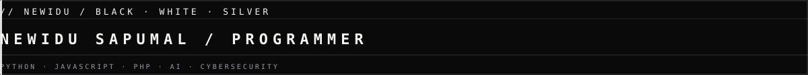

<div align="center">


# NS / NEWIDU

### PROGRAMMER · SECURITY · AI · AGENTS · CRYPTO

[](https://newidu.netlify.app/)
[](https://github.com/newidu)
[](https://x.com/NewiduSapumal)
[](https://t.me/Newidu)


</div>




<div align="center">

`// PORTFOLIO — MMXXVI — BLACK · WHITE · SILVER`

</div>

> I am Newidu Sapumal, a programmer and cybersecurity researcher from Sri Lanka. I build AI tools, automation systems, APIs, and open-source projects.

`OPEN SOURCE` · `CYBERSECURITY` · `AI AGENTS` · `CRYPTO INTELLIGENCE` · `UI ENGINEERING`

---

## ABOUT NEWIDU

# BUILDING SYSTEMS WITH
# CODE, AI & SECURITY.

I am **Newidu Sapumal** from **Sri Lanka**. I work as a programmer, cybersecurity researcher, AI developer, and agent builder. My main focus is creating practical software that connects programming, automation, intelligent systems, APIs, and security.

I share my work publicly on GitHub, including AI agents, messaging tools, speech-to-text systems, web API clients, networking experiments, and crypto-intelligence projects. I am interested in building useful products, learning new technologies, and collaborating with people who enjoy solving difficult technical problems.

<div align="center">

| `14+` | `06` | `24/7` |
| :---: | :---: | :---: |
| PUBLIC REPOS | DISCIPLINES | BUILDING |

</div>

```python
class Newidu:
    location = "Sri Lanka"
    focus = ["Programming", "Cybersecurity", "AI", "Agents", "Crypto", "Interfaces"]
    weapons = ["Python", "JavaScript", "PHP"]
    principle = "Build useful things. Learn constantly. Share openly."
```

## CAPABILITIES — INDEXED 01→06

| Index | Capability | What I ship |
| :---: | :---: | :---: |
| `01` | **Programming** | Single-file scripts to full platforms — Python and JavaScript/Node as daily weapons. |
| `02` | **Cybersecurity** | VPN and proxy tooling, protocol work, and research-first system testing. |
| `03` | **AI Development** | AI pipelines that turn raw data into decisions people can use. |
| `04` | **Agent Builder** | Autonomous agents designed, orchestrated, and deployed for real work. |
| `05` | **Crypto & Forex** | Market intelligence, structured signals, and volatility research. |
| `06` | **Interface Work** | Motion, typography, hierarchy, and front-ends with a point of view. |

<div align="center">


</div>

---

## SELECTED WORK — READ THE RECEIPTS

### FLAGSHIP VERIFIED / 01

<div align="center">

# TRENDORACLE LABS

`PYTHON` · `AI / ML` · `CRYPTO DATA` · `HACKATHON BUILD`

</div>

An AI-powered crypto intelligence platform built for the **Bitget AI × Crypto Trading Hackathon**. It ingests market chaos, runs it through an AI pipeline, and returns clean, tradable signal — not vibes.

<div align="center">

[](https://www.trendoracle.online/)
[](https://github.com/newidu/TrendOracle-Labs)

</div>

### OTHER RECEIPTS

`02` [ssh-vpn-nodejs](https://github.com/newidu/ssh-vpn-nodejs) · SSH / VPN / NODE  
`03` [v2ray-nodejs](https://github.com/newidu/v2ray-nodejs) · V2RAY / HTML  
`04` [v2ray-nodejs-v2](https://github.com/newidu/v2ray-nodejs-v2) · V2RAY / JAVASCRIPT  
`05` [live-strem](https://github.com/newidu/live-strem) · LIVE STREAMING  
`06` [deepseek-web2api-tgbot](https://github.com/newidu/deepseek-web2api-tgbot) · AI / TELEGRAM / JAVASCRIPT  
`07` [gemini-safe-mcp](https://github.com/newidu/gemini-safe-mcp) · AI / MCP / PYTHON

## PROJECT INDEX — AUTO-SYNCED

<!-- PROJECTS:START -->

_Automatically synced from 14 public repositories._

| Project | Description | Language | Stars | Updated |
| :---: | :---: | :---: | :---: | :---: |
| [My-Video-Agent](https://github.com/newidu/My-Video-Agent) | Open-source project by Newidu. | HTML | 0 | 2026-11-02 |
| [video-agent](https://github.com/newidu/video-agent) | Open-source project by Newidu. | JavaScript | 0 | 2026-11-01 |
| [tg-bot](https://github.com/newidu/tg-bot) | Open-source project by Newidu. | — | 0 | 2026-10-24 |
| [gemini-safe-mcp](https://github.com/newidu/gemini-safe-mcp) | Open-source project by Newidu. | Python | 0 | 2026-10-21 |
| [whatsapp-php](https://github.com/newidu/whatsapp-php) | Simple PHP WhatsApp Web bot with QR login and web launcher | PHP | 0 | 2026-10-21 |
| [xapiweb](https://github.com/newidu/xapiweb) | xapiweb is a zero-dependency Python client library for web API operations on X (Twitter). It does not require an OAuth application, and it reuses your browser session. | Python | 1 | 2026-10-14 |
| [voice-stt-api](https://github.com/newidu/voice-stt-api) | Open-source project by Newidu. | Python | 0 | 2026-10-13 |
| [deepseek-web2api-tgbot](https://github.com/newidu/deepseek-web2api-tgbot) | deepseek-web2api-tgbot is a Telegram bot that sits on top of the DeepSeek web app — it's not built on the paid developer platform: it signs in with your own browser session… | JavaScript | 0 | 2026-09-18 |
| [deepseek-harness](https://github.com/newidu/deepseek-harness) | DeepSeek Harness: Everything is a Plugin. | — | 0 | 2026-08-17 |
| [TrendOracle-Labs](https://github.com/newidu/TrendOracle-Labs) | AI-Powered Crypto Intelligence Platform built for the Bitget AI x Crypto Trading Hackathon. | Python | 0 | 2026-06-18 |
| [live-strem](https://github.com/newidu/live-strem) | Open-source project by Newidu. | — | 0 | 2026-05-07 |
| [v2ray-nodejs](https://github.com/newidu/v2ray-nodejs) | Open-source project by Newidu. | HTML | 0 | 2026-05-03 |
| [ssh-vpn-nodejs](https://github.com/newidu/ssh-vpn-nodejs) | Open-source project by Newidu. | HTML | 0 | 2026-04-18 |
| [v2ray-nodejs-v2](https://github.com/newidu/v2ray-nodejs-v2) | Open-source project by Newidu. | JavaScript | 0 | 2026-04-18 |

<!-- PROJECTS:END -->

---

## CURRENT FOCUS

# WHAT I AM
# BUILDING NOW.

I am currently working on AI agents, MCP tools, cybersecurity research, automation workflows, web APIs, and technology projects related to crypto and forex. I am also improving my project documentation, UI engineering skills, and open-source contribution workflow.

## ACHIEVEMENTS / MILESTONES

<div align="center">

[](https://github.com/newidu)

</div>

- **Open-source builder:** 14 public repositories currently synced to this profile.
- **AI and crypto innovation:** TrendOracle Labs was built for the Bitget AI × Crypto Trading Hackathon.
- **Community signal:** xapiweb has a public star from the GitHub community.
- **Automation enabled:** the project index syncs automatically through GitHub Actions.

> GitHub's official achievement badges are earned automatically through qualifying activity. The trophy wall updates as new achievements are unlocked.

## SYSTEM ACTIVITY

<div align="center">


<br />


<br />

[](https://github.com/newidu)

</div>

---

## CONTACT — THREE DOORS, ALL OPEN

# LET'S BUILD TOGETHER.

If you want to discuss AI development, cybersecurity, automation, APIs, open source, or a new technical project, you can contact me through my portfolio, X, Telegram, or GitHub.

<div align="center">

[**X / Twitter** @NewiduSapumal](https://x.com/NewiduSapumal) · [**Telegram** @newidu](https://t.me/Newidu) · [**GitHub** github.com/newidu](https://github.com/newidu)

</div>

<div align="center">


`NEWIDU SAPUMAL`  
`PROGRAMMER · SECURITY · AI · AGENTS · CRYPTO`

</div>
